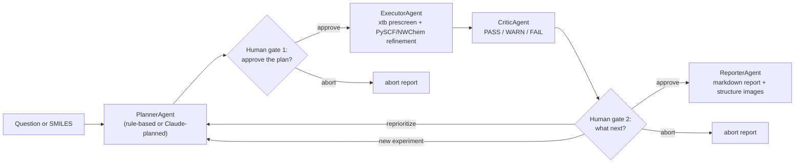

# CompChem

An agentic computational chemistry workflow: a plan → approve → execute → critique → approve → report loop that turns a molecule (or a plain-language research question) into a computed result, with a human staying in the loop at two points and every step captured as provenance.

The repo has two generations of code in it:

- **The agentic pipeline** (`src/agents/`, `src/skills/`, `src/engines/`, `src/llm/`, `src/storage/`) — the active, actively-developed workflow described in this README. Runs entirely locally today (RDKit + ASE + xtb + PySCF), with NWChem wired in as an alternate refinement engine and HPC deployment underway (see [Project status](#project-status)).
- **The original hand-written pipeline** (`conformer.py`, `fragmenter.py`, `nwchem.py`, `bde_workflow.py`, `run_all.py`, `parser.py`) — the earlier bond-dissociation-energy (BDE) workflow this project started from: RDKit conformer search + bond fragmentation, hand-written NWChem `.nw` input generation, Parsl-based job submission, BDE math from parsed NWChem output. Still present and functional, now running through the same Flowcept provenance layer as everything else, but no longer where new work lands.

A publication describing this work is planned.

## How it works



Four real [Academy](https://github.com/academy-agents/academy) actor agents talk to each other, orchestrated by `agents/run_agentic_campaign.py`:

- **PlannerAgent** turns a bare SMILES into a rule-based campaign spec, or a natural-language question into one via a real Claude API call — including recognizing multi-species questions (e.g. a bond dissociation energy needs a parent *and* fragments, not just one molecule) and reasoning about correct charge/multiplicity.
- A **human approval gate** pauses here: nothing computes until the plan is approved (or aborted).
- **ExecutorAgent** runs the analysis by dispatching to a pluggable skill (`src/skills/`, currently `single_point` and `bde`): a fast GFN2-xTB (xtb) geometry optimization, followed by a DFT refinement (PySCF by default; NWChem is wired in as an alternate refinement engine — see [Project status](#project-status)).
- **CriticAgent** reviews the result for physical plausibility (convergence, missing energies, spin-state sanity) and returns PASS/WARN/FAIL.
- A second **human approval gate** shows the results and verdict, and lets you **approve** (finalize), **reprioritize** (send feedback back through the planner for a revised spec — a real Claude call, bounded by `--max-replan-rounds`), start a **new experiment** (fresh SMILES or question), or **abort**.
- **ReporterAgent** writes a markdown report with every species' energy and a rendered structure image.

Every agent decision and every LLM call — including each human approval-gate choice — is captured as its own provenance record via [Flowcept](https://github.com/ORNL/flowcept), following a PROV-AGENT-style extension (`agent_tool` / `ai_model_invocation`), not just the underlying calculation tasks.

## Installation

```bash
conda env create -f environment.yml
conda activate compchem-agent
```

This installs RDKit, ASE, PySCF, cclib, Parsl, `tblite[ase]` (GFN2-xTB), `pymol-open-source`, Flowcept, `academy-py`, and the `anthropic` SDK. The macOS OpenMP environment variables xtb/PySCF need (`KMP_DUPLICATE_LIB_OK`, `OMP_STACKSIZE`, `OMP_NUM_THREADS`) are baked into the environment's own activate hook — nothing to set by hand.

For the LLM-planned path (anything using `--question`, or "reprioritize" at the post-analysis gate), pick one of three backends (`--ollama` and `--claude-cli` are mutually exclusive; neither given means the Anthropic default):

- **Anthropic (default)** — the hosted Claude API. Set an API key in your shell:
  ```bash
  export ANTHROPIC_API_KEY="<key>"
  ```
- **Ollama (`--ollama` flag)** — a local model via a running `ollama serve`, no API key and no network call. Pull a tool-calling-capable model first (`ollama pull llama3.1` or similar), then pass `--ollama` (optionally `--model <name>` to pick which pulled model to use, default `llama3.1` / `$OLLAMA_MODEL`). Local models honor the tool-call schema less reliably than Claude does, so expect the bounded self-correction retry to kick in more often — see `src/llm/planner_llm.py`'s module docstring for details.
- **Claude Code CLI (`--claude-cli` flag)** — no API key either, but for a different reason: it shells out to `claude -p` and authenticates with your existing Claude Code login instead. Just needs Claude Code itself installed and logged in. Still counts against that login's usage/plan (not free), and is slower per call than a direct API request since each attempt spawns a real (tool-less) Claude Code session — see `src/llm/planner_llm.py`'s module docstring for how it fakes structured output (plain-text JSON instructions, since `claude -p` has no native tool-calling).

## Usage

All commands run from `src/` (the agent modules import as `agents.*`/`skills.*`, so they need to run as `python -m ...` from that directory, not as a bare script):

```bash
cd src
```

**Quickest smoke test** — a rule-based single-point calculation on water, gates skipped for a scripted run:

```bash
python -m agents.run_agentic_campaign --auto-approve
```

**A specific molecule**, still rule-based:

```bash
python -m agents.run_agentic_campaign "CCO"   # ethanol
```

**A natural-language question**, LLM-planned, with the human approval gates live (omit `--auto-approve` to see them):

```bash
python -m agents.run_agentic_campaign --question "What's the O-H bond dissociation energy for water in kcal/mol, using a cheap xtb prescreen and a DFT refinement?" --model claude-haiku-4-5-20251001
```

Same question, planned locally via Ollama instead (no API key):

```bash
python -m agents.run_agentic_campaign --question "What's the O-H bond dissociation energy for water in kcal/mol, using a cheap xtb prescreen and a DFT refinement?" --ollama --model llama3.1
```

Same question again, planned via the logged-in Claude Code CLI instead (also no API key):

```bash
python -m agents.run_agentic_campaign --question "What's the O-H bond dissociation energy for water in kcal/mol, using a cheap xtb prescreen and a DFT refinement?" --claude-cli
```

At each gate, respond at the prompt:
- Plan gate: `y` (approve) or `n` (abort).
- Post-analysis gate: `a` (approve), `r` (reprioritize, then give feedback text), `n` (new experiment, then give a new question or SMILES), or `x` (abort).

**Useful flags**:

| Flag | Effect |
|---|---|
| `--question "..."` | Plan via an LLM (Anthropic by default, or Ollama/Claude-Code-CLI with `--ollama`/`--claude-cli`) instead of a bare SMILES |
| `--ollama` | Use a local Ollama model instead of the Anthropic Claude API for LLM-backed planning — no API key needed |
| `--claude-cli` | Use the logged-in Claude Code CLI (`claude -p`) instead of the Anthropic Claude API — no API key needed, but uses the CLI's own login |
| `--model <name>` | Override the planning model (defaults to `claude-sonnet-5`/`$ANTHROPIC_MODEL` for Anthropic/`--claude-cli`, or with `--ollama`, `llama3.1`/`$OLLAMA_MODEL`) |
| `--auto-approve` | Skip both human approval gates (for scripted/unattended runs) |
| `--max-replan-rounds <N>` | Cap on how many times "reprioritize" can send the spec back through the planner (default 2) |

### Output

- The terminal prints the spec, each species' xtb/refinement energy, and the critic's verdict as the campaign runs.
- `agentic_campaign_report.md` (written to `src/`, gitignored, regenerated per run) is the final human-readable report, with structure images under `report_structures/`.
- `flowcept_buffer.jsonl` (also gitignored, regenerated per run) holds the full provenance record. Inspect the agent-decision/LLM-call layer specifically with:
  ```bash
  python verify_agent_provenance.py
  ```

### Adding a new analysis type

Add a module under `src/skills/` exposing `NAME`, `DESCRIPTION`, `run(spec)`, `review(results)`, and `describe(spec, results, verdict)`, then register it in `skills/__init__.py`. `PlannerAgent`'s LLM tool schema and `ExecutorAgent`/`CriticAgent`/`ReporterAgent` all pick it up automatically — no changes needed to those classes.

## Project status

- The local path (RDKit → xtb → PySCF, rule-based or LLM-planned, both `single_point` and `bde` analyses, both human approval gates) is complete and working end-to-end.
- NWChem is wired in as an alternate ASE-calculator refinement engine (`engines/nwchem_engine.py`) but is not yet selectable by either planner, and isn't yet validated against a real binary run through the agent pipeline.
- HPC deployment (OLCF Defiant) is in progress: NWChem 7.2.3 has been built successfully via Spack on Defiant; a Slurm functional test of that binary is in progress. A Globus Compute endpoint for dispatching work from a laptop to Defiant has been stood up and confirmed running, paused pending that validation.

## Repo layout

```
src/
  agents/       Academy actors: planner, executor, critic, reporter, human_gate, and the CLI driver
  skills/       Pluggable analysis types (single_point, bde) dispatched by the agent layer
  engines/      QC engines: xtb, PySCF, NWChem (ASE-bridged), plus RDKit->ASE conversion and PyMOL rendering
  llm/          Claude-API-backed campaign planning and replanning
  storage/      Flowcept provenance helpers, agent-decision provenance, CSV/record storage
  analysis/     BDE math and PASS/WARN/FAIL QC classification (shared across both pipeline generations)
  parsers/      cclib-based output parsing with an NWChem-specific regex fallback
  conformer.py, fragmenter.py, nwchem.py, bde_workflow.py, run_all.py, parser.py
                The original hand-written BDE pipeline (Parsl-orchestrated, still functional)
environment.yml Conda environment definition
```
